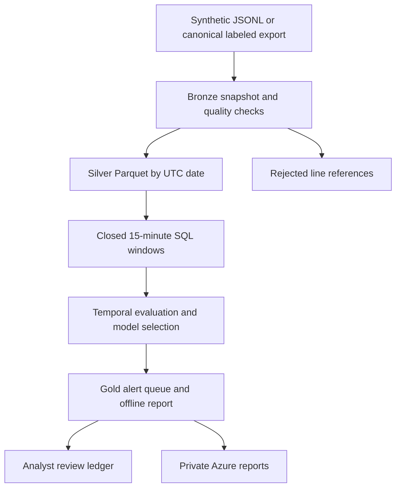

# AegisLake

**Identity threat analytics: security data engineering, reproducible machine learning, and human-led investigation.**

A portfolio project by Carlo Alessandro Cabrera. AegisLake turns authentication events into a small security data lake, compares detection methods under an analyst workload budget, and produces an offline investigation dashboard.

> Verified synthetic demo: 31 tests pass with 87% measured coverage; dependency audit, Bicep build, and non-root Docker execution pass. [Execution evidence](https://github.com/krlokbrera/aegislake/actions/runs/41214818529). Live Azure deployment remains pending.

[Spanish guide](docs/GUIA_ES.md) · [Research and design](docs/RESEARCH_ES.md) · [Azure](docs/AZURE.md) · [Model card](docs/MODEL_CARD.md) · [Data card](docs/DATA_CARD.md) · [Interview walkthrough](docs/CV_AND_INTERVIEW_ES.md)

## Why this project

A suspicious login is useful only if an analyst can investigate it. This project treats detection as a data product: reliable ingestion, explicit data contracts, temporal evaluation, traceable evidence, and bounded review workload. It combines the data engineering and cybersecurity experience that a generic classification notebook usually separates.

| Capability | Implemented evidence |
| --- | --- |
| Data engineering | Bronze snapshot, validated silver Parquet partitions, SQL feature aggregation, gold outputs |
| Analytics | Daily SOC KPIs, quality reconciliation, feature drift diagnostics, offline report |
| Applied AI | Rules, Isolation Forest, logistic regression, hybrid score, validation-only model selection |
| ML evaluation | Train/validation/test by time; average precision; precision/recall; false positives; daily capacity |
| Security | Keyed pseudonymization, no model pickle loading, private Blob access, no keys in code |
| Human oversight | Evidence summaries and a local append-only-at-application-level review ledger |
| Azure engineering | Bicep, optional finite Container Apps Job, managed identity, scoped RBAC |
| Delivery | Python package and CLI, Docker, tests, GitHub Actions, source-backed design documentation |

## Run the local demo

Python 3.11 or 3.12 is recommended. Run from the repository root:

```bash
python -m venv .venv
# Windows PowerShell:
.venv\Scripts\Activate.ps1
# Linux/macOS: source .venv/bin/activate
python -m pip install --upgrade pip
python -m pip install ".[dev]"
aegislake demo --output runs
```

The CLI prints the completed run directory. Open its `report.html` in your browser. It is a self-contained, offline report with a searchable investigation queue.

Default workload: 30 days, 50 identities, seed 42, 18 training days, six validation days, six test days, and at most 25 queued user windows per test day. These are simulator settings, not organization-wide capacity recommendations.

```bash
pytest --cov=aegislake --cov-report=term-missing
ruff check src tests scripts
pip-audit --progress-spinner off
```

For Docker:

```bash
docker build -t aegislake:local .
docker run --rm -v aegis-demo:/app/runs aegislake:local
# The named volume retains output; copy it using a separate read-only container if needed.
```

## Data flow



The reference implementation is single-node batch processing. It does not claim streaming delivery guarantees, distributed exactly-once processing, or incident response automation.

## Useful commands

```bash
# Evaluate your canonical labeled dataset:
aegislake run --input data/labeled-events.jsonl --output runs --train-days 18 --validation-days 6

# Record a review; replace the run path and alert identifier:
aegislake review --run runs/RUN_ID --alert-id ALERT_ID --decision needs_context --reviewer analyst-01

# Adapt an existing Graph JSON export after setting AEGIS_PSEUDONYM_KEY privately:
aegislake adapt-entra --input data/graph-export.json --output data/pseudonymous.jsonl

# Score future unlabeled events from an integrity-checked reference:
aegislake score --reference runs/RUN_ID --input data/future.jsonl --output runs/future-batch

# Upload only synthetic reports after Azure login and scoped RBAC setup:
python -m pip install ".[azure]"
aegislake publish --run runs/RUN_ID --account YOUR_STORAGE_ACCOUNT
```

Synthetic-trained references require an explicit `--allow-domain-shift` for new-batch scoring. This is an experimental interoperability path, not validation on Entra telemetry.

## Outputs

Each completed run contains:

- `bronze/events.jsonl`: original snapshot, kept locally.
- `silver/event_date=.../events.parquet`: validated partitions.
- `quarantine/rejected.json` and `quality.json`: disposition accounting.
- `gold/*_features.parquet`: train, validation and test windows.
- `gold/alerts.json`: evidence queue without ground-truth labels.
- `report.html` and `report.json`: results and limitations.
- `manifest.json`: input hash, configuration, versions and output hashes.
- `reviews.sqlite`: created when an analyst records a decision.

Raw telemetry and outputs are ignored by Git. GitHub Actions uploads only synthetic reports, manifests, coverage and an environment record.

## Verification evidence and remaining scope

Read [VALIDATION_STATUS.md](docs/VALIDATION_STATUS.md) for observed checks and remaining limits. [A generated synthetic report](examples/demo/report.html), its JSON metrics and manifest are included for inspection. Azure student access and live deployment are pending.

## License

MIT for original project code. External datasets retain their own terms and attribution requirements. No employer or client data is included.
